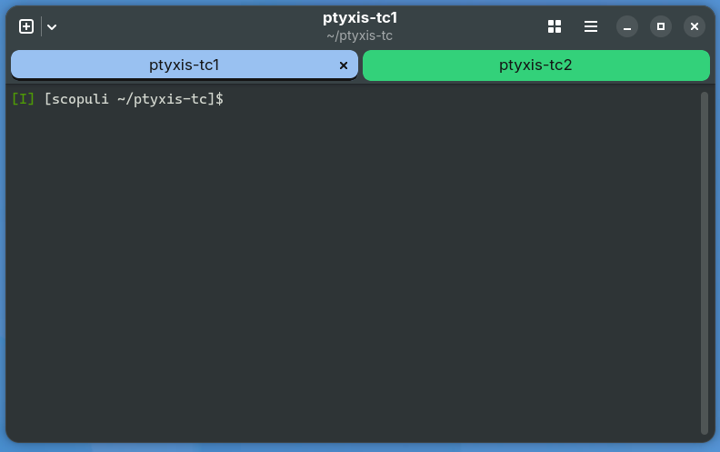

# Ptyxis-TC

An unofficial [Ptyxis](https://gitlab.gnome.org/chergert/ptyxis) fork with
hostname-based tab colors, manual tab colors, and right-click copy/paste.



## Project status and support

Ptyxis-TC is provided **as is, without warranty**. **No technical support is
provided.** There is no commitment to ongoing maintenance, updates, or
compatibility with future operating system or dependency versions.

Bug reports, enhancement requests, and proposed fixes or improvements are
welcome through this project's [GitHub repository](https://github.com/greenfinch628/ptyxis-tc)
or [Gitea repository](http://scopuli:3000/scopuli/ptyxis-tc) and will be considered
at the maintainer's discretion. Submitting a report, request, or contribution
does not guarantee a response, investigation, acceptance, fix, or implementation.
No release or completion date is promised.

This is an unofficial project and is not affiliated with or endorsed by the
upstream Ptyxis developers. Updates do not necessarily follow upstream releases;
upstream bug fixes and security fixes may not be included promptly, or at all.
The warranty terms in the GNU General Public License continue to apply; see
[COPYING](COPYING).

## Features

- Automatic tab background colors based on hostnames and SSH aliases.
- Manual tab colors through the tab context menu.
- A 3-pixel white underline identifies the active tab. Default backgrounds are
  active #e8e8e8 and inactive #c0bfbc, with independent color overrides.
- Manual colors retained during session restoration.
- Drag tabs between existing windows, including single-tab windows, or drag out
  to create a new window. Drop at the desired position in the destination tab bar;
  sessions, history, profiles and tab colors stay with the tab. Empty source
  windows close when the move finishes. Normal windows keep a tab bar even with
  one tab; standalone command windows retain their existing behavior.
- Right-click copies selected text and clears the selection; with no selection, it pastes.
- Enable or disable right-click copy/paste in Preferences → Behavior → Mouse.
  It is enabled by default; middle-click in the terminal text area opens the context menu
  instead of pasting the primary selection while enabled.
  Disabling it restores normal right-click context menu and middle-click behavior.
  Left-button text selection, dragging, and highlighting use normal mouse behavior.
  The preference is saved across restarts.
- Shift+right-click opens the original terminal context menu.
- Separate application ID and settings, so it can coexist with Fedora's regular Ptyxis.

Custom changes started on Ptyxis 50.1. The `main` branch preserves both the
custom changes and newer upstream history, currently reporting version 50.2.

## Build on Fedora

Clone the repository:

```bash
git clone git@github.com:greenfinch628/ptyxis-tc.git
cd ptyxis-tc
```

Install build dependencies:

```bash
sudo dnf install meson ninja-build gcc gettext-devel glib2-devel gtk4-devel \
  libadwaita-devel vte291-gtk4-devel json-glib-devel libportal-devel \
  libportal-gtk4-devel desktop-file-utils
```

Configure, build, and run the upstream checks:

```bash
meson setup build-tc --prefix=/opt/ptyxis-tab-colors-50.1 \
  --buildtype=debugoptimized \
  -Dapp-id=org.gnome.Ptyxis.TabColors \
  -Dgschema-id=org.gnome.Ptyxis.TabColors \
  -Dgschema-path=/org/gnome/Ptyxis/TabColors/
meson compile -C build-tc
meson test -C build-tc --print-errorlogs
```

The installation prefix retains its original `50.1` name for compatibility
with existing launchers. See [custom/README.md](custom/README.md) for source
installation, dependency versions, configuration, and compatibility details.

## Ubuntu 26.04 package

The validated Ubuntu 26.04 amd64 DEB is available in
[packages/ubuntu-26.04/](packages/ubuntu-26.04/) and through
[GitHub Releases](https://github.com/greenfinch628/ptyxis-tc/releases).
To install the package from this checkout:

```bash
sudo apt install ./packages/ubuntu-26.04/ptyxis-tc_50.2-6ubuntu26.04.1_amd64.deb
```

APT resolves the required Ubuntu dependencies. Ubuntu 24.04's stock
libadwaita and VTE libraries do not meet this version's requirements.
Close and reopen Ptyxis-TC after installation or upgrading. Launch it with
`ptyxis-tc`, `ptyxis-tab-colors`, or the Ptyxis-TC application menu entry.
The package preserves the separate application ID and settings.

Verify the package from the repository root:

```bash
(cd packages/ubuntu-26.04 && sha256sum -c SHA256SUMS)
```

Matching Debian source files and the Ubuntu build report are available on
the release page. See the release notes for the source commit and package build details.

## Local RPM on Scopuli

The current Fedora 44 x86_64 package is stored under `packages/fedora-44/`.
Revision 7 includes the independent tab colors and master reset, and has been
installed and verified on Scopuli, Rocinante, Karakum, and Narlikar. Build inputs
and temporary outputs under `local-rpm/` remain excluded from Git.

```bash
sudo dnf install ./packages/fedora-44/ptyxis-tc-50.2-7.fc44.x86_64.rpm
```

Close and reopen Ptyxis-TC after upgrading. Launch it from the application
menu or run `ptyxis-tc` (also available as `ptyxis-tab-colors`).
The local `local-rpm/README.md` contains RPM rebuild instructions.

## Application icons

The launcher displays **ptyxis-tc** and uses
`ptyxis-tc-blue-border-gray3.svg` by default. Additional custom icons are
installed alongside the original upstream full-color and symbolic icons.
The application ID remains `org.gnome.Ptyxis.TabColors`.

The seven custom variants are in [`data/icons/`](data/icons/):
`ptyxis-tc-blue`, `ptyxis-tc-blue-bg1`, `ptyxis-tc-blue-border`, and
`ptyxis-tc-blue-border-gray0`, `gray2`, `gray3`, and `gray4` (each gray
variant has the full `ptyxis-tc-blue-border-` filename prefix).

RPM and DEB packages install the custom SVGs, with their distinct filenames,
under `/usr/share/icons/hicolor/scalable/apps/` and
`/opt/ptyxis-tab-colors-50.1/share/icons/hicolor/scalable/apps/`.
The original upstream icon remains available as
`org.gnome.Ptyxis.TabColors.svg`; the preserved upstream symbolic icon is
`org.gnome.Ptyxis.TabColors-symbolic.svg` in the corresponding
`hicolor/symbolic/apps/` directories. Source installations also place the
icons under the installation prefix; the custom installation instructions
install a user-local set in `~/.local/share/icons/hicolor/`.

To choose another launcher icon, copy the installed desktop file to
`~/.local/share/applications/org.gnome.Ptyxis.TabColors.desktop` and edit
its `Icon=` line. Use the icon filename without `.svg`, for example
`Icon=ptyxis-tc-blue-border-gray2`, or use
`Icon=org.gnome.Ptyxis.TabColors` for the original upstream artwork.
Keep `Exec=` and the application identity unchanged. A user-local desktop
file takes precedence and survives package upgrades. Refresh the launcher
or sign out and back in if your desktop caches the previous icon. This
changes the launcher icon; the application's built-in icon remains gray 3.

The package build recipes are now tracked in [`packaging/rpm/`](packaging/rpm/)
and [`debian/`](debian/); see [packaging/README.md](packaging/README.md) for
rebuild instructions. Previously published packages remain unchanged;
these icon defaults apply to new builds using the updated recipes.

## Hostname colors

Create or edit `~/.config/org.gnome.Ptyxis.TabColors/tab-colors.ini`.
Use [custom/tab-colors.ini](custom/tab-colors.ini) as an example and replace
its hosts and aliases with your own. Changes are read automatically.

This source reads the user configuration file; the legacy RPM configuration
at `/etc/ptyxis-tc/tab-colors.ini` is not read. Copy any desired mappings from
that file into your user configuration.

## Active and inactive tab colors

**Preferences → Appearance → Tab Colors** provides separate default active and
inactive backgrounds and optional active/inactive text colors. Each control has
a reset button. Tab text defaults to black in both states, regardless of background.
Explicit text colors override black; resetting a text color restores black and
updates its swatch. Preferences shows saved text colors when reopened.
The **Default** button applies active `#e8e8e8` and inactive `#c0bfbc` backgrounds
in one step. This pair is also built in for first startup and new tabs without
manual or hostname overrides. The button preserves text colors and host mappings.
Individual background reset arrows restore the same built-in colors.
The active tab retains a white underline even when both backgrounds match.
Tab switching updates the appearance through GTK selection state immediately.

Right-click a tab for **Active Tab Background Color…** (the existing manual
color action) or **Inactive Tab Background Color…**. **Automatic Tab Color**
clears both manual backgrounds. Both overrides survive session restoration when
Restore Session is enabled, using the existing session mechanism.

The existing `[Hosts]` mappings continue to supply active backgrounds. Optional
`[InactiveHosts]` mappings supply inactive backgrounds using the same hostname,
short hostname, default, and SSH alias lookup. A manual active color replaces
the automatic host pair; a manual inactive color can be assigned independently.

Preferences stores defaults in `[Appearance]` in the existing `tab-colors.ini`:

```ini
[Appearance]
active-background=#e8e8e8
inactive-background=#c0bfbc
# Optional; omit for black text:
# active-foreground=#000000
# inactive-foreground=#000000

[InactiveHosts]
scopuli=#b9cfea
```

Manual backgrounds take priority, followed by hostname mappings, then Appearance
defaults. Without an explicit color, the built-in active `#e8e8e8` and inactive
`#c0bfbc` pair applies. Existing saved colors remain in effect until changed or
reset; configuration and sessions need no migration.
Configuration-file edits and color assignments refresh within half a second.
Invalid colors are ignored. Preferences preserves existing mappings and comments.

## Reset all settings

At the bottom of **Preferences → Appearance**, **Reset All Settings…** restores
initial application preferences, profile settings, keyboard shortcuts, tab colors,
and SSH color mappings. A confirmation lists the scope; Cancel changes nothing.
The Tab Colors **Default** button remains available for just the two backgrounds.

The master reset keeps a private backup under
`~/.local/state/org.gnome.Ptyxis.TabColors/reset-backups/` before changing settings.
The completion message shows its exact location. `settings.ini` records schema
IDs, paths, and typed user values; `config/` holds the old color configuration
and saved session, and `live-session.gvariant` captures the session state before resetting.
If the backup cannot be created, the reset stops without changing preferences.

Open terminal processes keep running and their tabs use a fresh default profile
and colors. Preferences closes; reopen it to view the initial settings. Old tabs
will not be saved or restored on the next launch; normal session saving resumes
in the next application run. Imported palette files are retained. The reset is
scoped to Ptyxis-TC; regular Ptyxis is unaffected. Installed and test TC builds
share settings, as before.

## Validation and compatibility

The current source built successfully on Scopuli (Fedora 44 x86_64) with
GTK 4.22.5, libadwaita 1.9.4, and VTE 0.84.1. All four Meson checks and the
custom tab-color integration test passed. The local RPM also passed digest
verification and an upgrade dry run.

Tab styling uses libadwaita internals and deprecated GTK style APIs, so other
library versions require verification. See
[custom/ARCHIVE-NOTES.md](custom/ARCHIVE-NOTES.md) for the original build and
validation history.

The active/inactive regression suite can be rerun after configuring `build-tc`:

```sh
python3 custom/run-color-tests.py build-tc
```

It uses a private display and temporary settings under `build-tc/color-tests`,
checks rendered background pixels across selection changes, SSH mapping logic,
manual color pairs, session/profile restoration, tab navigation actions, and
Preferences save/reset behavior. Logs and screenshots are saved with the tests.

## License and attribution

Licensed under GPL version 3 or later; see [COPYING](COPYING).
Original copyright and license notices are retained.

Ptyxis is developed upstream by Christian Hergert and contributors.
Modified by Bob Czys, October 5, 2026.
The original upstream README is preserved in [README-upstream.md](README-upstream.md).

## Current packages

Revision 6 RPM and DEB packages, checksums, and corresponding source are
available in [packages/](packages/README.md). Use the package matching your OS.
